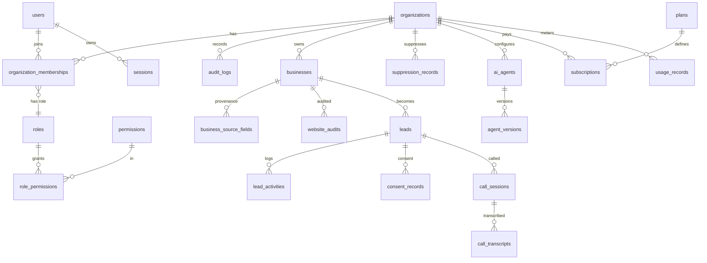

# LEADEX AI — Database Design

PostgreSQL 16. Conventions: UUID PK `id`; `created_at`, `updated_at` (timestamptz); tenant-owned tables
carry `organization_id UUID NOT NULL REFERENCES organizations(id)` + index; soft delete via
`deleted_at` where business records may be restored; sensitive columns (integration secrets, MFA
secrets) encrypted with Fernet (key from secrets manager). RLS policy on every tenant table:
`USING (organization_id = current_setting('app.current_org', true)::uuid)`.

## ER overview

## Tables by context
| Context | Tables | Phase |
|---|---|---|
|Identity|organizations, users, roles, permissions, role_permissions, organization_memberships (user↔role per org), sessions|1 ✅|
|Administration|audit_logs, idempotency_keys|1 ✅|
|Administration|integrations, integration_credentials, notifications, support_tickets|2 / 10|
|Discovery|businesses, business_sources, business_source_fields, business_verifications, website_audits, saved_searches, search_jobs|3|
|CRM|leads, lead_contacts, lead_scores, lead_assignments, lead_activities, lead_notes, lead_tasks|2|
|Compliance|consent_records, consent_evidence, suppression_records, communication_preferences, data_retention_records|2–3|
|AI|ai_agents, agent_versions, agent_tools, agent_knowledge, agent_evaluations, model_configurations|4|
|Voice|call_sessions, call_events, call_transcripts, call_summaries, call_recordings, call_dispositions|5|
|Campaigns|campaigns, campaign_recipients, campaign_approvals, campaign_events|7|
|Communication|email_accounts, email_campaigns, email_messages, whatsapp_accounts, whatsapp_templates, whatsapp_messages|7|
|Websites|website_projects, website_versions, website_templates, website_deployments, website_feedback|6|
|Marketplace|customers, service_providers, provider_documents, service_categories, customer_requirements, provider_matches, referrals, commission_agreements, commission_transactions|8|
|Automation|workflows, workflow_versions, workflow_nodes, workflow_executions, workflow_execution_events|9|
|Billing|plans, subscriptions, usage_records, invoices, payments|10 (usage_records in 3)|

## Phase 1 schema (authoritative: `apps/api/alembic/versions/`)
- **organizations**(id, name, slug UNIQUE, country_code, is_platform_owner, status, created_at, updated_at, deleted_at)
- **users**(id, email UNIQUE (stored lower-case), password_hash, full_name, is_active, is_superadmin, mfa_enabled, mfa_secret_enc, last_login_at, created_at, updated_at)
- **permissions**(id, code UNIQUE e.g. `members:write`, description)
- **roles**(id, organization_id NULL = system role, name, description, UNIQUE(organization_id, name))
- **role_permissions**(role_id, permission_id) composite PK
- **organization_memberships**(id, organization_id, user_id, role_id, status, UNIQUE(organization_id, user_id))
- **sessions**(id, user_id, refresh_token_hash UNIQUE, expires_at, revoked_at, user_agent, ip_address, created_at)
- **audit_logs**(id, organization_id NULL, actor_user_id, action, entity_type, entity_id, data JSON, ip_address, created_at) — append only
- **idempotency_keys**(id, organization_id, key, request_hash, response JSON, created_at, UNIQUE(organization_id, key))

RLS is enabled in migration `0002` on `organization_memberships`, `audit_logs` and `idempotency_keys`
(PostgreSQL only). The application connects as table owner during development; in production the app
must use a non-owner role so RLS is enforced (`FORCE ROW LEVEL SECURITY` is also set).

## Audit vs mutable data
`audit_logs` is insert-only; the production role is granted INSERT/SELECT only. Business tables are
mutable and soft-deleted.
